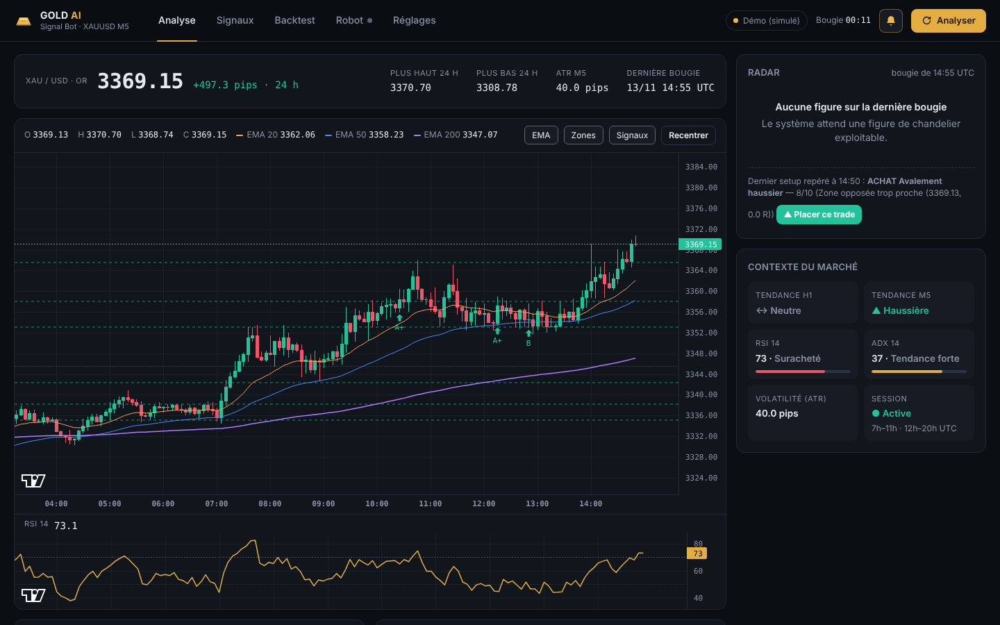
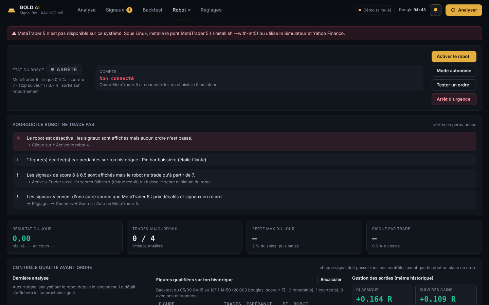
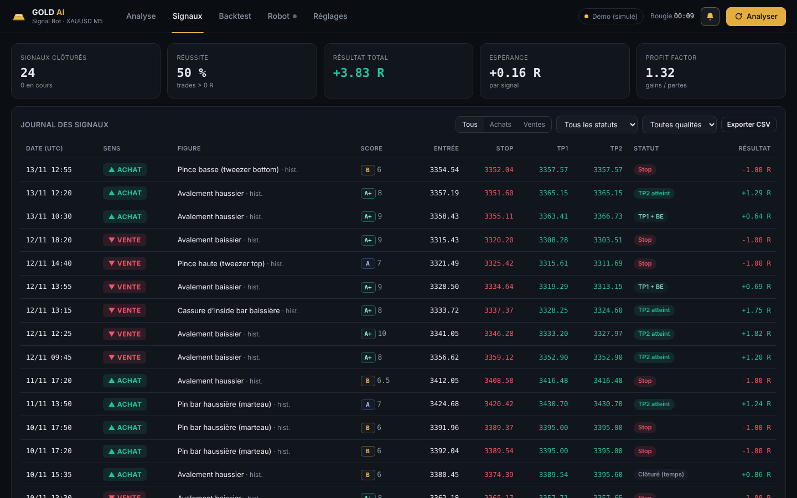
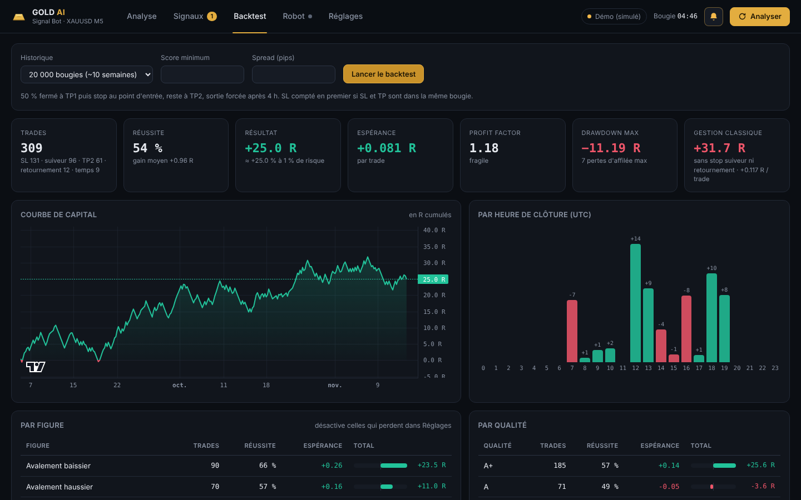

# Gold AI Signal Bot — XAUUSD M5

**Espace d'analyse et robot de trading de l'or (XAUUSD) en M5**, basé sur les chandeliers japonais —
la même analyse que [EURUSD M5 Analyzer](https://github.com/ck526438-lgtm/eurusd-m5-analyzer),
réglée pour l'or : graphique en direct, **radar** qui note chaque bougie sur 10 et explique pourquoi,
zones de support / résistance, contexte M15 / H1 / H4, journal qui suit le résultat de chaque signal,
backtest complet, filtre d'**IA** validé hors échantillon et **robot MetaTrader 5** avec gestion du risque.
Application **Windows** (installateur `.exe`), alertes dans le navigateur, le terminal et Windows.



📘 **[Guide d'utilisation (PDF)](docs/Guide_Gold_AI_Signal_Bot.pdf)**

> ⚠️ Le trading de l'or comporte un risque élevé de perte. Le robot est **désactivé par défaut** et
> **refuse les comptes réels** tant que tu ne l'autorises pas. Valide la stratégie par le backtest sur
> **tes** données MT5, puis en Simulateur et sur **compte démo** avant tout passage au réel.

---

## Ce qui change par rapport à la v1

La v1 (moteur à règles 0-100 + ML, en ligne de commande) reste disponible sous le tag
[`v1-regles-ml`](../../tree/v1-regles-ml). Son propre banc d'essai l'avait montré honnêtement :
**sur 77 000 bougies réelles, aucun des moteurs ne battait les coûts** (spread 0,33 $ + glissement),
et le ML était légèrement négatif. La v2 reprend le moteur de l'analyseur EURUSD, qui ajoute ce qui
manquait :

| | v1 | v2 |
|---|---|---|
| Analyse | score 0-100 de 6 familles d'indicateurs | 12 figures de chandeliers + confluence /10 expliquée critère par critère |
| Contexte | tendance EMA | tendances M15 / H1 / H4, zones S/R avec nombre de touches, ADX, RSI, sessions |
| Filtrage | seuil de score | **contrôle qualité** : figure rentable sur **ton** historique, tendances alignées, pas d'annonce USD à ±30 min, volatilité, probabilité IA |
| IA | prédiction directe du sens (AUC 0,52) | probabilité qu'un **signal** soit gagnant, validée sur une période jamais vue ; elle ne bloque que si elle fait mieux que la stratégie seule |
| Gestion | SL/TP en ATR | lot selon le risque, TP1 + TP2, break-even, stop suiveur, sortie sur retournement, entrée sur repli, pause après perte du jour |
| Interface | terminal | application Windows (navigateur local), assistant de démarrage, journal, backtest graphique |
| MT5 | exécution verrouillée | robot démo par défaut + **EA autonome** pour MetaTrader 5 |

**Réglages adaptés à l'or** (1 pip = 0,10 $ = 10 points) : stop de 25 à 150 pips (2,50 $ à 15 $),
spread simulé 3,3 pips (0,33 $, mesuré sur ForexClub démo), spread maximum 6 pips, volatilité ATR M5
acceptée de 10 à 120 pips, sessions Londres 7 h–11 h et New York 12 h–20 h UTC, annonces **USD**
seulement, détection des noms `XAUUSD`, `XAUUSDm`, `XAUUSD.pro`, `GOLD`, `GOLDm`…

> Le moteur est meilleur pour **expliquer** le marché et **filtrer** les setups, mais rien ne garantit
> qu'il gagne sur l'or en M5 : le spread y pèse lourd. C'est pour ça que le robot ne trade que les
> figures **prouvées rentables sur ton propre historique** (recalculé chaque jour). Lance un backtest
> de 50 000 bougies sur tes données MT5 avant d'activer quoi que ce soit.

---

## Installation (Windows)

1. Ouvre la page **[Releases](../../releases)** et télécharge `Gold-AI-Signal-Bot-Setup-x.y.z.exe`.
2. Lance l'installateur (si Windows SmartScreen s'affiche : *Informations complémentaires* →
   *Exécuter quand même*). Options : raccourci Bureau, lancement au démarrage de Windows.
3. Ouvre **MetaTrader 5**, connecte-toi, affiche l'or dans *Observation du marché*, active **Algo Trading** (pour le robot).
4. Lance **Gold AI Signal Bot** depuis le menu Démarrer : l'interface s'ouvre sur
   `http://localhost:8010`, la fenêtre noire affiche les notifications.

Aucun Python à installer. Les réglages, le journal et l'historique du robot sont dans
`%LOCALAPPDATA%\Gold AI Signal Bot` et sont conservés lors des mises à jour. Une version **portable**
(zip) est aussi publiée dans chaque Release. L'application peut tourner **à côté d'EURUSD M5 Analyzer** :
port, dossier de données et numéro magic sont différents.

Au premier lancement, un **assistant** détecte MetaTrader 5, le compte, le nom de l'or chez ton
courtier et le décalage horaire. **Réglages → État du système** vérifie tout et indique quoi corriger.

## Installation (Kali Linux, Debian, Ubuntu)

```bash
tar xzf gold-ai-signal-bot-linux-*.tar.gz && cd gold-ai-signal-bot-*/   # archive de la page Releases
./install.sh                # analyse (prix Yahoo GC=F) + robot en Simulateur
./install.sh --with-mt5     # + MetaTrader 5 sous Wine et son pont : robot réel depuis Linux
./install.sh --service      # + démarrage automatique à l'ouverture de session
gold-ai                     # lancer (ou menu Applications → Gold AI Signal Bot)
```

### Depuis le code source

```bash
git clone https://github.com/ck526438-lgtm/gold-ai-signal-bot.git
cd gold-ai-signal-bot
pip install -r requirements.txt MetaTrader5
python main.py                   # ou start.bat sous Windows ; --demo pour un marché simulé
```

---

## Robot de trading (onglet Robot)



À chaque signal validé (score ≥ 7 par défaut), le robot :

- **calcule le lot** à partir du risque choisi (0,5 % du solde par défaut) et de la distance du stop,
  avec la valeur du mouvement fournie par MT5 (contrat de 100 onces, toutes devises de compte) — arrondi vers le bas ;
- ouvre **2 positions** (TP1 et TP2) avec stop et objectifs enregistrés chez le courtier ;
- déplace le stop de la 2ᵉ position **au prix d'entrée** quand TP1 est atteint ;
- **suit les gains** avec un stop suiveur : dès +1 R, le stop suit le meilleur prix à 0,7 R
  de distance et ne recule jamais (vérifié toutes les 3 s tant qu'une position est ouverte) ;
- **coupe automatiquement au retournement** : figure de chandelier inverse (score ≥ 6), et en
  option perte d'élan (clôture qui repasse l'EMA 20 avec le RSI de l'autre côté de 50) ou
  cassure du dernier creux / sommet formé depuis l'entrée ;
- clôture ce qui reste après **4 h**.

Le stop suiveur et la sortie sur retournement sont rejoués dans le backtest avec les mêmes
règles, et comparés chaque jour à la gestion classique (TP1 / break-even / TP2) sur ton
historique : si la gestion classique fait mieux, le robot l'utilise à la place (réglable).

**Réactivité et précision** — avec MetaTrader 5, le robot guette l'apparition de la nouvelle
bougie chez le courtier et analyse ≈ 1 s après la clôture (au lieu d'un délai fixe de 8 s) ;
les entrées sur repli et les stops suiveurs sont surveillés chaque seconde / toutes les 3 s.
**Entrée sur repli** (option) : au lieu d'entrer au marché, le robot attend que le prix revienne
d'une fraction du risque vers le stop (0,3 R par défaut, 3 bougies max) — stop plus court, même
objectif ; annulée si TP1 ou le stop est touché avant. Rejouée à l'identique dans le backtest et
soumise à la même comparaison quotidienne que le suivi des gains. **Profils** en un clic :
Débutant (0,25 %, 3 trades/jour), Équilibré, Actif (scores faibles à risque réduit, 2 positions,
12 trades/jour), **Tous les signaux** (dès le score 4, risque ÷ 2 sous 7, sans filtre de
statistiques / tendances / IA, 3 positions, 20 trades/jour, coupe au premier retournement ;
annonces, spread et perte maximale du jour restent actifs). L'EA a le même mode
(`InpTakeAllSignals`).

> Le marché Démo a des mèches artificielles qui favorisent à tort l'entrée sur repli : juge-la
> uniquement sur tes données MetaTrader 5.

**Le robot ne trade pas ?** L'onglet Robot affiche en haut « Pourquoi le robot ne trade pas » :
robot désactivé, bouton Algo Trading, score sous le minimum du robot, figures perdantes sur
l'historique, refus des 7 derniers jours par raison… Chaque signal non tradé est noté avec sa
raison dans l'activité du robot. Le bouton **Tester un ordre** (compte démo) ouvre puis ferme
le lot minimum pour vérifier que les ordres passent. Les figures sans assez d'historique ne
sont plus bloquées (seules celles prouvées perdantes le sont — réglable).

**Bouton « Placer »** — sur le signal en direct (radar), sur la notification d'un nouveau signal
et sur les signaux récents de l'onglet Signaux (moins de 30 min) : un récapitulatif (prix actuel,
écart depuis le signal, stop, objectifs, lot, montant risqué, contrôles que le robot aurait refusés)
puis l'ordre part, **même si le robot est désactivé**. Garde-fous conservés : démo sauf autorisation,
Algo Trading, pause de perte journalière, spread, lot selon le risque, potentiel restant ≥ 0,5 R.
La position est ensuite gérée comme les autres. EA : `InpAutoTrade = false` → boutons PLACER /
IGNORER sur le graphique et notification sur le téléphone.

**Encaisser le profit** (Réglages du robot) — *Petit* : objectif unique à 0,6 R (stop suiveur dès
0,4 R) ; *Moyen* : 1,2 R (stop suiveur dès 0,7 R) ; ou personnalisé. Le trade entier est fermé à
l'objectif. Plus de trades gagnants, mais des gains plus petits : sur des prix aléatoires,
l'espérance ne change pas — seul le backtest sur ton historique dit si c'est mieux. EA :
`InpQuickTargetR`.

**Trades à score faible** (désactivé par défaut) — le robot peut aussi prendre les signaux
à partir d'un score plus bas (5 par défaut) avec un **risque réduit** (moitié par défaut).
Tous les autres contrôles s'appliquent quand même, et le backtest pondère ces trades par le
risque réellement engagé.

**Contrôle qualité avant chaque ordre** — en plus du score de l'analyse, le signal doit passer :
- **validation statistique** : la figure doit être rentable sur ton propre historique
  (backtest recalculé chaque jour : ≥ 20 trades, espérance ≥ +0,05 R, profit factor ≥ 1,1), et l'heure ne doit pas être perdante ;
- **tendances M15 / H1 / H4** : aucune contre le trade, au moins deux dans son sens ;
- **annonces économiques** : pas d'ordre à ±30 min d'une annonce majeure USD (NFP, CPI, Fed…) ;
- **volatilité** : ATR M5 entre 10 et 120 pips (1 $ à 12 $) ;
- **probabilité IA** : voir ci-dessous.

**Intelligence artificielle** — un modèle (gradient boosting, scikit-learn) apprend sur ton
historique la probabilité qu'un signal soit gagnant, à partir de 25 caractéristiques connues à la
clôture de la bougie (score, figure, tendances M15/H1/H4, RSI, ADX, volatilité, distance aux EMA,
élan, position dans le range, potentiel jusqu'à TP2, heure, jour). Validation **chronologique** :
apprentissage sur les 60 % les plus anciens, seuil choisi sur les 20 % suivants, **mesure finale sur
les 20 % les plus récents, jamais vus** (avec une zone tampon de 4 h entre les périodes). L'onglet
Robot affiche le résultat « stratégie seule » contre « avec filtre IA » sur cette période test,
l'AUC, la fiabilité des probabilités et les caractéristiques qui comptent le plus. Le filtre
**ne bloque des ordres que s'il a fait mieux que la stratégie seule** sur la période test ; sinon
la probabilité reste indicative (affichée dans le radar). Réentraîné chaque jour.

> Aucun modèle ne prédit le marché avec certitude : les chiffres affichés sont mesurés, pas promis,
> et peuvent se dégrader quand le marché change.

Chaque contrôle est expliqué (✓ / ✕) dans l'onglet Robot et enregistré avec chaque ordre.

**Sécurités** : désactivé au lancement · comptes démo uniquement sauf autorisation (« REEL »,
redemandé à chaque activation) · **pause automatique** après −2 % dans la journée · max 4 trades
par jour et 1 ouvert à la fois · spread et écart de prix maximums · signal de moins de 3 min ·
jamais deux fois le même signal · lot plafonné · **arrêt d'urgence** qui clôture toutes ses
positions (jamais les tiennes, reconnues par le numéro magic 730526) · mode **Simulateur** sans argent.

Identifiants MT5 optionnels dans `.env` (voir `.env.example`), sinon le compte connecté au terminal est utilisé.

---

## Versions autonomes

**Mode autonome de l'application** (onglet Robot → *Mode autonome*) : démarrage avec la session
sans fenêtre, robot activé et relancé automatiquement, anti-veille Windows, alertes si les données
n'arrivent plus, bilan du jour. Si tu désactives le robot toi-même, il n'est pas relancé.

**Robot MT5 autonome (Expert Advisor)** — `mql5/Gold_AI_Signal_Bot_EA.mq5`, compilé à chaque
version (`Gold_AI_Signal_Bot_EA.ex5` dans les fichiers de la release) : la même analyse (12 figures,
score /10, zones, tendances M15/H1/H4, contrôles volatilité / annonces / spread / limites) et la
même gestion (lot selon le risque, TP1 + TP2, break-even, stop suiveur, sortie sur retournement,
entrée sur repli, sortie au temps, pause sur perte journalière) tournent **directement dans
MetaTrader 5**, sans Python — sur ton PC ou sur le VPS MetaTrader 24 h/24, avec notifications sur
l'appli MT5 du téléphone. Sans les statistiques par figure ni l'IA. Démo uniquement par défaut.
Installation : copie le `.ex5` dans *Fichier → Ouvrir le dossier des données → MQL5/Experts*, puis glisse-le sur un graphique XAUUSD M5.

## Ce que contient l'espace

### Analyse
- **Graphique** chandeliers M5 (600 bougies) avec EMA 20/50/200, zones S/R, flèches des signaux
  passés (cliquables) et niveaux Entrée / SL / TP1 / TP2 du signal en cours ; **RSI** synchronisé.
- **Radar** : la dernière bougie clôturée est analysée et notée sur 10, critère par critère
  (✓ / ✕ avec les points). S'il n'y a pas de signal, il dit **pourquoi** (score trop bas, zone
  opposée trop proche, stop trop large, hors session…).
- **Contexte** : tendance H1 et M5, RSI, ADX, volatilité (ATR), session en cours.
- **Zones clés** classées autour du prix, avec leur solidité (nombre de touches) et la distance en pips.

### Signaux
Journal de tous les signaux (SQLite) avec **suivi automatique** : en cours, TP2 atteint,
TP1 puis BE, stop, clôturé au temps — et le résultat en R. Filtres, détail du score, **note
personnelle** par signal, export CSV.



### Backtest
Sur 1 500 à 50 000 bougies : réussite, espérance, profit factor, drawdown, série de pertes,
**courbe de capital**, résultats **par figure**, **par qualité** et **par heure**.



### Réglages
Tout se règle dans l'interface (enregistré dans `config.yaml`) : source des données, score
minimum, filtres, gestion du risque, **figures actives** (désactive celles que le backtest
montre perdantes), notifications.

---

## Notifications

| Où | Quoi |
|---|---|
| **Terminal** | Une ligne de suivi à chaque clôture M5 + un bandeau coloré avec bip à chaque signal |
| **Navigateur** | Son + notification système + toast (cloche en haut à droite) |
| **Windows** (option) | Notification bureau même navigateur fermé — `pip install plyer` puis activer dans Réglages |

Exemple dans le terminal :

```
14:10  XAUUSD 4012.35  H1 ▲  RSI 58  ADX 31  ATR 41.2p  │  ACHAT Avalement haussier 8.5/10

 ▲ ACHAT XAUUSD  ·  qualité A+  ·  score 8.5/10
  Avalement haussier  —  bougie clôturée 06/11 14:15 UTC
  Entrée 4012.35   Stop 4007.15 (52.0 pips)   TP1 4020.15 (1:1.5)   TP2 4025.35 (1:2.5)
    ✓ Figure : Avalement haussier  +3
    ✓ Dans le sens de la tendance H1  +2
    ✓ Rejet du support 4006.80 (2 touches)  +2
    ...
```

Mode terminal seul (sans navigateur, robot inclus) : `python main.py watch`.

---

## La méthode

À chaque clôture M5 (+8 s pour laisser le courtier publier la bougie) :

**1. Figures de chandeliers** — avalement, pin bar (marteau / étoile filante), étoile du matin /
du soir, trois soldats / trois corbeaux, pinces (tweezer), cassure d'inside bar. Les
micro-bougies (< 0,6 ATR) sont ignorées.

**2. Score de confluence /10**

| Critère | Points |
|---|---|
| Force de la figure (+1 si plusieurs figures concordent) | 1 à 3 |
| Sens de la tendance **H1** | +2 (−2 si contre) |
| EMA 20/50 M5 alignées · bon côté de l'EMA 200 | +1 · +0,5 |
| Rejet d'une zone S/R (forte si ≥ 2 touches) ou rebond sur les EMA | +1 à +2 |
| RSI qui confirme (pas en excès) | +1 (−1 si excès) |
| ADX ≥ 18 | +1 (−1 sinon) |
| Session Londres (7 h–11 h UTC) / New York (12 h–20 h UTC) | +0,5 |

Qualité : **A+** ≥ 8 · **A** ≥ 7 · **B** ≥ 6 (seuil réglable).

**3. Risque** — stop derrière la mèche + 0,25 ATR (25 à 150 pips, soit 2,50 $ à 15 $), TP1 = 1,5 R, TP2 = 2,5 R ramené
avant la zone opposée ; setup refusé si une zone bloque à moins de 1,2 R.

Aucune donnée future n'est utilisée (bougies clôturées uniquement, tendance H1 prise à la
clôture de l'heure) — c'est vérifié par un test automatique.

---

## Sources de données

| Source | Usage |
|---|---|
| **MetaTrader 5** (recommandé) | Windows, terminal MT5 ouvert. Règle le **symbole** exact (`XAUUSD`, `XAUUSDm`, `GOLD`…) et le **décalage horaire** du serveur (souvent 2 ou 3) |
| Yahoo Finance | Gratuit, partout : contrat à terme COMEX **GC=F** (quelques dollars d'écart avec le XAUUSD), 60 jours max — analyse seulement, pas pour placer des ordres |
| CSV | Ton propre historique (`time,open,high,low,close` en UTC) |
| Démo | Marché simulé pour découvrir l'interface — **prix non réels** |

`auto` essaie MT5 puis Yahoo.

## Commandes

```bash
python main.py                    # espace d'analyse (navigateur + terminal) — ou Gold-AI-Signal-Bot.exe
python main.py watch              # terminal uniquement
python main.py scan               # une analyse puis quitte
python main.py backtest --bars 50000
python main.py selftest           # vérifie l'installation
# options : --demo  --source mt5|yfinance|csv  --csv FICHIER  --port 8010  --no-browser  --no-bell
```

API documentée sur `http://localhost:8010/api/docs`.

## Structure

```
analyzer/
  patterns.py    figures de chandeliers
  indicators.py  EMA, RSI, ATR, ADX, tendance H1
  structure.py   pivots et zones S/R
  strategy.py    score de confluence, SL/TP, radar
  backtest.py    simulation des trades
  quality.py     contrôle qualité avant ordre (statistiques, M15/H1/H4, annonces, volatilité)
  ml.py          modèle IA : probabilité de gain, validation walk-forward
  executor.py    robot : garde-fous, lot, ordres, break-even, stop suiveur, retournement, pause
  broker.py      courtiers MetaTrader 5 et Simulateur
  mt5link.py     connexion MT5 persistante, recherche des terminaux installés
  mt5bridge.py   client du pont MetaTrader 5 (Linux)
  onboarding.py  assistant de démarrage et diagnostic
  journal.py     journal SQLite + suivi des résultats
  service.py     boucle d'analyse
  server.py      API FastAPI + flux temps réel
  terminal.py    notifications terminal
  data.py        MT5 / Yahoo / CSV / démo
web/             interface (HTML/CSS/JS, graphiques TradingView Lightweight Charts)
bridge/          serveur du pont MetaTrader 5 (tourne sous Wine, Linux)
install.sh       installation Linux ; scripts/setup-mt5-wine.sh pour MT5 sous Wine
packaging/       exécutable (PyInstaller) et installateur Windows (Inno Setup)
tests/           tests (moteur, anti-lookahead, IA sans fuite de données, API, robot et pont avec faux MT5, assistant)
```

Tests : `pip install -r requirements-dev.txt && python -m pytest -q`

Graphiques : [TradingView Lightweight Charts™](https://www.tradingview.com/lightweight-charts/) (Apache 2.0).

## Publier une nouvelle version

```bash
git tag v2.0.1 && git push origin v2.0.1     # ou : Actions → Installateur Windows → version
```
GitHub Actions lance les tests sous Windows, construit l'exécutable, vérifie qu'il démarre
(`selftest`), crée l'installateur, ajoute l'archive Linux et publie la Release avec le guide PDF.
